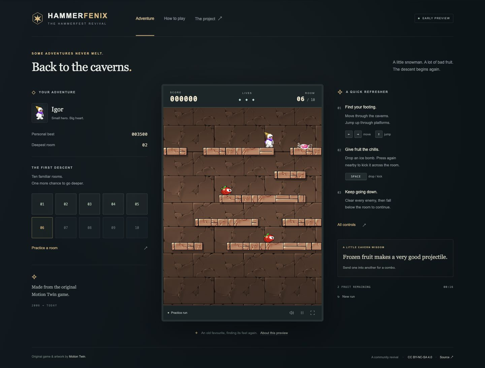

# HammerFenix

A native web recreation of **Hammerfest**, the 2006 platform game by Motion Twin.

**Status: first playable milestone, not a complete port.** Play the opening ten combat rooms using the original layouts, backgrounds, character animations, and sounds. The full adventure and tutorial data have been decoded for the next stages of development.



## Run locally

Use Node.js 24 LTS (or Node >=22.12):

```sh
npm ci
npm run dev
```

Open the local address printed by Vite, normally **http://127.0.0.1:5173**.

```sh
npm run check   # simulation/content tests, TypeScript checks, production build
npm run build   # static site in dist/
npm run preview # serve the production build locally
```

The production build is static and works under a subdirectory. Serve `dist/` with any static HTTP host; opening `index.html` directly with `file://` is not supported. No backend, account, CDN, runtime framework, Java, or Flash plugin is needed to play. Java is only an optional asset-conversion tool.

## Play

| Action | Keyboard | Standard gamepad |
| --- | --- | --- |
| Move | Left / Right, A / D, Q / D | D-pad / left stick |
| Jump | Up, W, Z | A / D-pad up |
| Drop / kick a bomb | Space, Ctrl, X | B |
| Kick a nearby bomb upward | Down + bomb | D-pad down + B |
| Pause / resume | P, Escape | Start |

Touch controls appear on narrow screens and touch devices. Hold jump to jump again on landing, as in the original. One bomb may be active at a time. Drop a bomb in the air for a small upward boost. Freeze fruit, knock it into other fruit, and descend after clearing the room. Falling from an uncleared room wraps to the top. Use **How to play → Practice a room** to start a practice run. Practice scores are excluded from the personal best.

The browser pauses the game on focus loss or when hidden. Records and mute preferences are saved locally; blocked or damaged storage does not prevent play.

## What is implemented

- Ten original combat layouts, corresponding to upstream adventure records **2–11**. Records 0–1 contain the exterior and scripted introduction.
- 400 × 500 world, 20 px tiles, fixed 32 Hz simulation, interpolated rendering.
- Source-derived movement, jumping, air damping, bomb fuse/radius/power and freeze duration.
- Original Igor animation states; cherries, oranges and apples; ice bombs; original sound effects and looping music.
- Bomb kicks, freezing, sliding ice collisions, chain scoring, score pickups, lives, temporary respawn protection, room transitions, and a completion screen.
- Pause, mute, fullscreen, room practice, local records, reduced decorative motion and responsive controls.
- Deterministic replay checks at 60 / 120 / 144 display Hz, swept collision tests and content integrity checks.

## Fidelity boundaries

This is a migration foundation. Enemy AI is a simplified implementation of the three opening enemy families; it is not a port of the original decision grid. Collision uses the source's one-way-platform model and constants but has not been validated frame by frame against Flash. Scoring, combo rewards and score-item distribution are provisional. Three starting lives, touch/gamepad controls, the surrounding interface and descriptive room names are adaptations.

The original level scripts are retained as data, **not executed**. The exterior, introduction, secret portals, special items, quests, unlocks, remaining enemies, later rooms, bosses, multiplayer, exact hurry-up pursuer and ending are not yet implemented. Having all 107 decoded adventure records does not mean those rooms are supported by the runtime.

See [architecture and migration plan](docs/ARCHITECTURE.md) and [asset provenance](docs/ASSETS.md).

## Credits and license

Original Hammerfest code, game design, art and audio © **Motion Twin**. Source: [motion-twin/hammerfest](https://github.com/motion-twin/hammerfest), pinned to `fa8624307c8168fdec0c18d644509af933e4af7b`.

HammerFenix is an independent adaptation, with modified code, converted animation assets and a new interface. The original license notice is retained in [LICENSE.txt](LICENSE.txt). This project is distributed under [CC BY-NC-SA 4.0](https://creativecommons.org/licenses/by-nc-sa/4.0/): attribution, noncommercial use and share-alike. It is not an official Motion Twin release.

Repository: [Greaple/HammerFenix2](https://github.com/Greaple/HammerFenix2).
